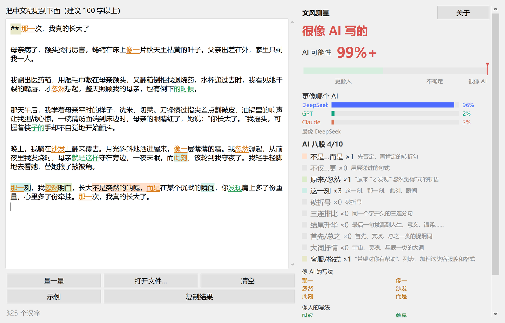

# AI腔尺子

贴一段中文进去，它告诉你三件事：

1. **这段字有多像 AI 写的**：一个校准过的可能性，外加一个很保守的结论（很像 AI / 不确定 / 更像人写的）；
2. **更像哪一家 AI**：DeepSeek、GPT、Claude 三选一，给出各自的分数；
3. **踩了哪几条「AI 八股」**：十条文风检查，在原文里直接标出来。

完全离线运行，不联网，不上传任何内容。只用 Python 标准库，下载下来就能用。

**浏览器 / B站 Toy 移植版**：见 [docs/toy-port.md](docs/toy-port.md)，网页源码在 `web/`，运行 `python scripts/build_toy.py` 生成可上传的 `toy-dist/`。网页首次加载需要下载模型，输入文字仅在浏览器本页处理。

原作者：[Claude大小姐在运营](https://space.bilibili.com/3747572619414174) · 原视频：[《AI 腔是怎么来的？》](https://www.bilibili.com/video/BV1xNsV6CE7d/)

> **先把话说在前面：这把尺子只量文风，不能证明是谁写的。**
> 人也会写出“AI 腔”（中学生作文里很常见），AI 也能写得一点不像 AI。
> 请别拿它的结果去指控任何人，尤其是学生的作文。



## 怎么用

需要 Python 3.8 或更新的版本。Windows 上从 python.org 下载的安装包自带 Tkinter，不用另装任何东西。

**窗口版**

- Windows：双击 `打开尺子.bat`；
- 其他系统：`python3 ruler_gui.py`。

把文字粘贴进左边，点「量一量」（或按 Ctrl+Enter）。第一次要等一两秒加载模型。右边出结果，原文里会标出踩中的八股；长文会分段打分，点「第 1 段」之类的小标签可以跳到那一段。「复制结果」可以把整份结果复制成文字。

**命令行**

```bash
python ruler.py 文件.txt              # 量一个文件（UTF-8 或 GBK 都行）
python ruler.py -t "一段文字"          # 直接量一段文字
python ruler.py --json 文件.txt        # 输出 JSON，方便别的程序用
python ruler.py --about               # 看模型的测试成绩
```

## 结果怎么看

- **结论**只有四种：「很像 AI 写的」「不确定」「更像人写的」，以及不到 50 个汉字时的「太短了」。
  判成「很像 AI」的门槛定得很高：定门槛时，2022 年以前的人类文字每一类被误判的都不超过 0.5%。代价是一半左右的 AI 文字会落进「不确定」。
- **AI 可能性**是一个估计，不是证明。界面上永远不会出现 0% 或 100%。
- **更像哪个 AI**：只在 DeepSeek、GPT、Claude 三家里选，别的 AI（文心、通义、Kimi……）它不认识，也会被硬分到三家之一。结论是「更像人写的」时，这一栏仅供参考。
- **AI 八股 x/10**：十条检查各数一遍，踩中几条就是几分。**它量的是文风，不是作者**——2021 年的中学生作文，整篇（约 600 字）平均踩 1.35 条，片段（约 250 字）0.63 条；AI 的片段（约 250 字）里 DeepSeek 1.30 条、GPT 0.70 条、Claude 0.55 条。字越多，踩中的机会越多，所以这个分数只适合和长度差不多的文字比（详见报告第五节）。
- **依据**：模型觉得最像 AI、最像人的几个词，只是帮你理解它为什么这样判，不代表这些词有问题。

十条「AI 八股」检查：

| 检查 | 抓什么 |
|---|---|
| 不是…而是 | 先否定、再肯定的转折句 |
| 不仅…更 | 层层递进的句式 |
| 原来/忽然 | “原来”“才发现”“忽然觉得”式的顿悟 |
| 这一刻 | 这一刻、那一刻、此刻、瞬间 |
| 破折号 | 破折号 |
| 三连排比 | 同一个字开头的三连分句 |
| 结尾升华 | 最后一句拔高到人生、意义、温柔…… |
| 首先/总之 | 首先、其次、总之一类的提纲词 |
| 大词抒情 | 宇宙、灵魂、星辰一类的大词 |
| 客服/格式 | “希望对你有帮助”、列表、加粗这类客服腔和格式 |

## 准不准

先看最要紧的：**它冤枉人的比例**。下表的人类文字都写于 2022 年以前，打分时模型没见过它们：

| 人类文字 | 段数 | 被判成「很像 AI」 | 「不确定」 |
|---|---:|---:|---:|
| 中学生作文（2021 年，从没拿来训练） | 858 | 1 段（0.12%） | 34% |
| 微博（约 2012 年，从没拿来训练） | 1500 | 2 段（0.13%） | 9% |
| 百科、医疗、法律等问答（从没拿来训练） | 1395 | 2 段（0.14%） | 25% |
| 民国课本名篇（《背影》《故乡》等，从没拿来训练） | 71 | 0 | 6% |
| 社区问答、点评、新闻、维基百科、心理和理财问答、民国散文（训练用的来源里没见过的文档） | 10115 | 2 段（0.02%） | 5% |
| **合计** | **13939** | **7 段（0.05%）** | |

再看 AI 文字。每一段都由**没见过这道题**的模型打分（按题目分组交叉验证）：

| AI 文字 | 段数 | 判成「很像 AI」 | 「不确定」 | 被当成「更像人写的」 | 猜对是哪家 |
|---|---:|---:|---:|---:|---:|
| DeepSeek | 251 | 43% | 51% | 6% | 64% |
| GPT | 226 | 39% | 55% | 6% | 68% |
| Claude | 240 | 47% | 50% | 3% | 81% |
| **合计** | **717** | **43%** | **52%** | **5%** | **71%** |
| 其中 500 字以上的长文（按整篇算） | 80 | 54% | 44% | 3% | — |
| Gemini 3.1 Pro（从没训练过的 AI） | 54 | 35% | 63% | 2% | — |
| 2023 年初的旧版 ChatGPT（这几类问题从没训练过） | 600 | 26% | 59% | 15% | — |

所以它是一把**偏向放过、尽量不冤枉**的尺子：判成「很像 AI」时基本可信；判成「不确定」时什么也说明不了；判成「更像人写的」时，仍有 5% 左右其实是 AI 写的。

难易差别很大。三批题目分开看，判成「很像 AI」的比例：第一批日常题目 60%，第二批问答、点评、百科、新闻 43%，第三批专挑最难的体裁（百科科普、新闻通知、点评、书信应用文、口语化的“像真人写的”）只有 20%。分体裁：日记 92%、说明 87%、随笔 81%、观点 67%、小故事 67%、问答 54%、书信 33%、朋友圈 28%、应用文 20%、点评 16%、科普 12%、百科 10%、新闻 3%。

「猜是哪家」三选一，随便猜是 33%，它猜对 71%。最常见的错是把 DeepSeek 和 GPT 猜成 Claude。

完整的数字、测试方法和每一类文字的结果在 [reports/eval_report.md](reports/eval_report.md)。

## 它是怎么做的

**AI 样本**（全部在 `data/ai/`，可以随便看）：

- 第一批 24 道日常题目（随笔、朋友圈、日记、观点、影评、科普、说明、书信、小故事、周报、好评、问答、初中作文），见 `train/prompts.json`；每家每题写 3 篇。
- 第二批 58 道题，专门写人类数据里多的体裁：33 道从公开问答数据里原样照抄的真实提问，加上点评、百科词条、新闻稿，见 `train/prompts_v2.json`；每家每题写 1 篇。
- 第三批 56 道题，专挑前两批测出来最弱的体裁：百科、科普、说明、新闻、通知、点评、书信、应用文，外加“用口语写、别写得太书面、像真人发的”这类题，见 `train/prompts_v3.json`；每家每题写 1 篇。
- 另外，从公开数据集 HC3-Chinese 里取了 150 段 2023 年初 ChatGPT 的回答放进 GPT 这一类（只占这一类权重的三成），让它也认得老版本的写法。
- 每一篇都是全新的对话，互相看不到。三家用同样的题目：

| | 用的模型和设置 |
|---|---|
| DeepSeek | 官方 API：deepseek-v4-pro（不思考）、deepseek-v4-pro（深度思考）、deepseek-flash，三种轮换 |
| GPT | codex 命令行：gpt-6.1-sol、gpt-6-chat-thinking、gpt-6.1-terra，三种轮换 |
| Claude | Claude Code 的子代理：Claude Opus 5.5 两份、Claude Sonnet 5.5 一份 |

**人类文字**：都写于 2022 年以前（ChatGPT 出现之前），来源和许可见下方「数据来源」。原文不放进这个仓库，仓库里只有从中算出的统计数字。

**模型**：

- 先把文字统一格式（全角半角、引号、省略号、破折号、数字、字母、Markdown 符号、空白），让模型看用词，不看排版；
- 特征有两组：一是相邻的 1～3 个字（字的 n-gram）；二是「虚词骨架」——只留下“的、了、是、就、而且、因为”这类虚词和标点，其余的字都换成占位符，再看相邻的 2～4 个符号。骨架不管写的是什么题材，只管句子是怎么搭起来的；
- 超过 500 字的长文，先在句末切成 300 字左右的几段，每段分别打分，再取平均（训练用的也都是 150～400 字的片段；整篇直接算会让模型过分自信，中学生整篇作文被误判的比例是分段算的好几倍）；
- 四个类别（人、DeepSeek、GPT、Claude）一起训练一个带 L2 正则的逻辑回归，人和 AI 各占一半权重；
- 「AI 可能性」用 Platt 方法校准，校准时每一类人类文字的权重相同，免得量大的类别把难判的类别（比如作文）淹没；
- 「很像 AI」的门槛：定门槛用的那一半人类文字里，每一类被误判的比例都不超过 0.5%；「更像人写的」的门槛：AI 文字落到它下面的不超过 5%。

**怎么测的（为什么这些数字可信一点）**：

- AI 文字按**题目**分组做交叉验证：每一篇都由一个没见过这道题的模型来打分，看它能不能举一反三，而不是背题目；
- 能拿来训练的人类数据，也是由没见过它的模型打分；
- 不能拿来训练的人类数据（中学生作文、微博等）一律只测不训，而且对半分：一半用来定门槛，另一半只用来报告成绩；
- 另外拿两种没训练过的 AI 测了一下：Gemini 3.1 Pro 写的 54 篇（`data/ai_eval/gemini/`），以及 2023 年初 ChatGPT 在百科、医疗、问答、法律这几类问题上的 600 段回答（这几类从没拿来训练）。

## 局限（请一定看）

- **样本不大**：三家各约 190 篇、138 道题。题材、长度（多为 100～600 字）以外的文字，结果都不可靠。
- **平实的说明文最难**：AI 写的百科词条、科普、新闻稿、点评，大多判不出来（多半落在「不确定」，百科和科普还有一两成被当成「更像人写的」）。它最认得出的是 AI 写的日记、随笔、小故事、作文、观点和问答。
- **别家和旧版的 AI 认得不全**：从没训练过的 Gemini 只有 35% 判成「很像 AI」（好在只有 2% 被当成人写的）；2023 年初的 ChatGPT 在没训练过的那几类问题上判出 26%，15% 被当成人写的。模型一换代，成绩还会掉。
- **最容易冤枉的人类文字**：带编号的清单式短文（“十个好习惯：1.… 2.…”）、辞藻很满的作文段落（作文腔）、带标题和列表格式的长回答。这些正是 AI 腔的来源之一。
- **生成方式**：AI 样本是通过 API 和编程助手生成的，不是在各家网页聊天里生成的；网页版有自己的系统提示词，文风可能不同。
- **改写、润色、人机合写**的文字，基本测不准。让 AI “写得像人一点”，大概率也能骗过它。
- **只认三家**：「更像哪个 AI」只在 DeepSeek、GPT、Claude 里选；文心、通义、Kimi、豆包等没有样本，这一栏对它们没有参考价值。
- **人类文字的覆盖面**：测过的是网络问答、点评、新闻、百科、微博、2021 年的中学生作文和民国名篇；公文、学术论文、当代小说、诗歌没有专门测过。
- **短文**：不到 100 字时，它更容易「不确定」；不到 50 字干脆不判。
- **繁体中文**没有测过。
- **AI 八股**只是十条文风规则，人也会踩，尤其是作文。

## 重新训练

训练只在重新训练时需要 numpy 和 scipy；用这个工具不需要。

```bash
cd train
bash fetch_human.sh <工作目录>            # 下载人类文字（放在仓库外面）
python fetch_pd_essays.py --work <工作目录>  # 维基文库的公有领域名篇
python build_human.py --work <工作目录>
python train.py --work <工作目录>          # 训练、评估，写出 aiqiang/model.json 和 reports/
python make_golden.py                      # 给测试用的对照值
python -m unittest discover -s ../tests
```

生成 AI 样本的脚本也在 `train/` 里：`gen_deepseek.py`、`gen_gpt.sh`、`collect_claude.py`（Claude 的样本由子代理逐篇写出）、`gen_gemini.py`（只做测试用的 Gemini 样本）。

## 数据来源

| 数据 | 内容 | 许可 | 用途 |
|---|---|---|---|
| [CLUECorpusSmall](https://github.com/CLUEbenchmark/CLUECorpus2020)（来自 [brightmart/nlp_chinese_corpus](https://github.com/brightmart/nlp_chinese_corpus)，经 [HF 镜像](https://huggingface.co/datasets/austenjs/ClueCorpusSmallDataset)） | 社区问答、点评、新闻等，2019 年以前 | MIT | 训练 |
| [HC3-Chinese](https://huggingface.co/datasets/Hello-SimpleAI/HC3-Chinese) open_qa | WebTextQA、BaikeQA 的人类回答 | MIT | 训练 |
| HC3-Chinese finance | FinanceZhidao 的人类回答 | CC BY 4.0 | 训练 |
| HC3-Chinese psychology | 心理问答的人类回答 | CC0 | 训练 |
| [CMRC 2018](https://huggingface.co/datasets/hfl/cmrc2018) | 中文维基百科段落 | CC BY-SA 4.0 | 训练 |
| [维基文库](https://zh.wikisource.org/) | 鲁迅、朱自清、许地山的散文和小说 | 公有领域 | 一部分训练；课本名篇只测不训 |
| [CEDCC](https://github.com/cubenlp/CEDCC_corpus)（EMNLP 2023） | 2021 年的中学生作文 | 未声明 | 只测不训 |
| [weibo_senti_100k](https://huggingface.co/datasets/dirtycomputer/weibo_senti_100k) | 约 2012 年的新浪微博 | 未声明 | 只测不训 |
| HC3-Chinese baike / nlpcc_dbqa / law | 百科、问答、法律问答的人类回答 | 未声明 | 只测不训 |
| HC3-Chinese medicine | 医疗问答的人类回答 | CC BY-NC 4.0 | 只测不训 |
| HC3-Chinese（ChatGPT 回答）open_qa / finance / psychology | 2023 年初 ChatGPT 的回答 | MIT / CC BY 4.0 / CC0 | 训练（150 段，放进 GPT 一类） |
| HC3-Chinese（ChatGPT 回答）baike / medicine / nlpcc_dbqa / law | 2023 年初 ChatGPT 的回答 | 同上各部分 | 只测不训（当作“没见过的 AI”） |
| Gemini 3.1 Pro（我们自己生成，见 `data/ai_eval/gemini/`） | 54 篇，题目同第一批和第三批 | 随代码以 MIT 发布 | 只测不训（当作“没见过的 AI”） |

“只测不训”的数据没有进入模型权重；其中各类文字对半分，一半用来校准「AI 可能性」、定「很像 AI」的门槛（一共只影响三个数），另一半只用来报告成绩。所有原文都留在仓库外面，这里一个字都不放。

## 许可

- 代码：MIT（见 [LICENSE](LICENSE)）。
- `aiqiang/model.json`（模型权重）：由上表“训练”一栏的数据算出，其中包括 CC BY-SA 4.0 的维基百科文字，因此以 [CC BY-SA 4.0](https://creativecommons.org/licenses/by-sa/4.0/deed.zh-hans) 发布，署名见上表。
- `data/ai/` 和 `data/ai_eval/` 里的 AI 样本：随代码一起以 MIT 发布。

## 声明

- 非 Anthropic 官方，与 DeepSeek、OpenAI、Anthropic 官方均无关。
- 这是 B 站「Claude大小姐在运营」的视频《AI 腔是怎么来的？》的配套小工具。
